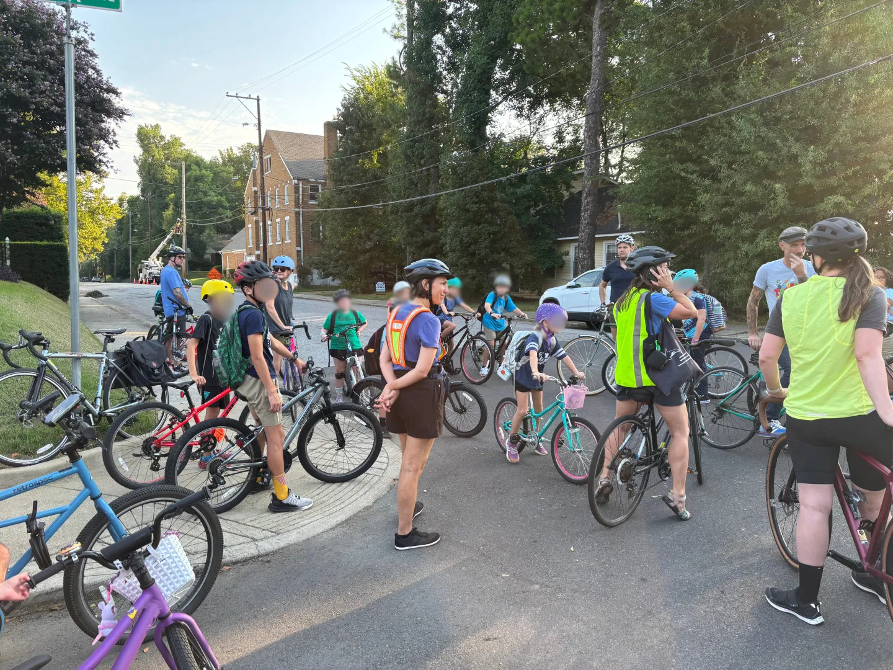

# What is it?

A bike bus is a group of people who bike to school together, picking up people along the way. It is a safe way for kids to get to school!

_Photo from City of Memphis Bike Ped Program [blog post](https://bikepedmemphis.wordpress.com/2026/08/20/idlewild-elementary-hosts-its-2nd-bike-bus-event/)_

<Card title="Idlewild Elementary hosts its 2nd Bike Bus event (Aug 2026)" icon="biking" horizontal href="https://bikepedmemphis.wordpress.com/2026/08/20/idlewild-elementary-hosts-its-2nd-bike-bus-event/">
  Blog post by City of Memphis about the Idlewild Elementary bike bus!
</Card>

<Card title="The Daily Memphian - Idlewild Elementary parents wanted their kids to have a safe way to bike to school. So they created a ‘bike bus.’" icon="biking" horizontal href="https://dailymemphian.com/subscriber/article/66364/idlewild-elementary-midtown-memphis-bike-bus">
  Written by John Klyce, September 8, 2026
</Card>

<Card title="Bike Bus World" icon="globe-africa" horizontal href="https://bikebus.world/">
  Bike Bus World is a national non-profit with resources on starting a bike bus
</Card>

<Card title="Coach Balto" icon="sportsball" horizontal href="https://www.instagram.com/coachbalto/">
  Coach Balto brought the Bike Bus to social media and has made it a worldwide phenomenon. Check out his Instagram to see some examples of bike buses in action.
</Card>

<iframe src="https://www.youtube.com/embed/GTaqGYFAJaE" title="YouTube video player" frameborder="0" className="w-full aspect-video rounded-xl" allow="accelerometer; autoplay; clipboard-write; encrypted-media; gyroscope; picture-in-picture; web-share" allowfullscreen />

# Memphis Bike Buses

Memphis has a few bike buses (that I know of). Send me an email to [kelsey@memphisurbanism.com](mailto:kelsey@memphisurbanism.com) if you know of more!

- Peabody Elementary
- Idlewild Elementary
- KIPP Memphis Public Schools

# Request more info

Interested in joining one of the Memphis bike buses or want to start your own? In the interest of children's safety, I do not publish any bike bus info publicly. Fill out this form and I'll get back to you!

<link href="https://actionnetwork.org/css/style-embed-v3.css" rel="stylesheet" type="text/css" />

<script src="https://actionnetwork.org/widgets/v6/form/bike-bus-interest-form?format=js&source=mu-website" />

